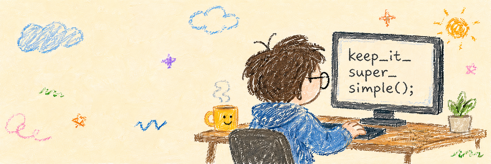

# Hello👋! I'm Young-in

- **웹 애플리케이션 서버**를 만들고 관리하는 법을 주로 가르칩니다 👨‍🏫
  - `Spring Boot` 기반 웹앱 설계와 구현을 위해 필요한 내용들을 가르칩니다
  - `LLM/GenAI`를 활용하여 생산성을 높이는 법과 해당 API를 활용하여 서비스를 만드는 법을 가르칩니다
  - `Docker` 등 컨테이너 환경을 활용하여 로컬/클라우드 인프라를 구축하는 법을 가르칩니다

- 코딩 패러다임의 변화에 적응하기 위해 아둥바둥 중입니다 👨‍💻
  - 평소엔 `React + Hono + Cloudflare`로 개인적으로 쓸 툴을 만드는 걸 좋아합니다
  - `Codex`, `Claude Code`, `Antigravity`, `OpenCode`, `Herdr` 등을 활용하여 **에이전틱 코딩**을 진행합니다
  - `AGENT.md`, `Skills`, `DESIGN.md` 등을 통해 **하네스 엔지니어링**을 적용해보고 있습니다

- 코딩, AI 시대의 지식 변화를 반영한 자료를 업데이트하고 있습니다 ✍️
  - [고깃집 순한맛 — Git·GitHub 입문 12강](https://echo.qus0in.dev/git-easy/): 저장소 만들기부터 커밋, 원격 연결, 브랜치 병합까지 다룹니다.
  - [Go Git 集 과정](https://echo.qus0in.dev/git/): Git의 버전 관리와 GitHub 협업을 익히는 교안입니다.

